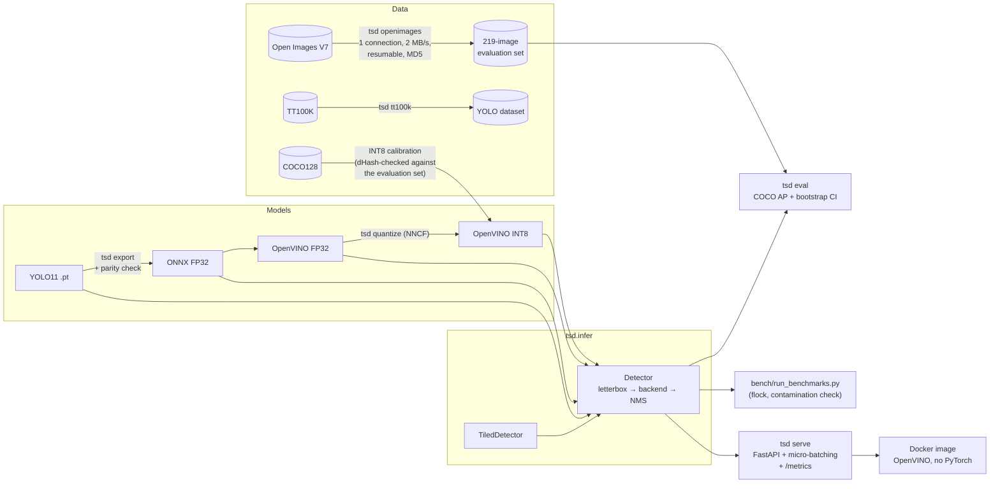

# Traffic-Sign-Detection

Running YOLO11 traffic-scene detectors fast on a CPU: export to ONNX and OpenVINO, INT8
quantization, a COCO-style evaluator with bootstrap confidence intervals, latency benchmarks that
hold up on a shared machine, sliced inference for small objects, and an HTTP service with dynamic
micro-batching, Prometheus metrics and a Docker image.

## Background

This started as a 2024 course project where our team trained YOLO11 on TT100K (201 traffic-sign
classes) on an A100. The code and weights from back then are gone, so in 2026 I rebuilt it,
this time focusing on deployment instead of training. The 2024 numbers come from our course
report and are kept apart from everything I measured for this version (see [Results](#results)).

## What's in here

| | |
|---|---|
| `tsd.infer` | One `Detector` (letterbox → backend → NumPy NMS → boxes in original pixels) for PyTorch, ONNX Runtime and OpenVINO; export with a parity check; NNCF INT8 quantization; sliced (tiled) inference |
| `tsd.eval` | COCO mAP (checked against pycocotools) on Open Images with its verified-label rules, 95% bootstrap intervals and paired differences between runtimes |
| `tsd.serve` | FastAPI: `POST /v1/detect`, `GET /healthz`, `GET /metrics`; asyncio micro-batching, a request limit checked before the upload is read (429), inference off the event loop |
| `tsd.data` | TT100K → YOLO converter, Open Images evaluation-set builder, near-duplicate check |
| `tsd.augment` | The perspective (homography) and sign-replacement augmentations from the 2024 project, with property tests |
| `tsd.net` | A careful downloader: 1 connection, 2 MB/s cap, resumable, size and MD5 checked |
| `bench/` | Benchmark matrix, load tester, batching comparison; results in `bench/results/` |
| `docs/` | [Evaluation protocol](docs/EVALUATION.md), [engineering notes](docs/ENGINEERING_NOTES.md), [model card](docs/MODEL_CARD.md), [the 2024 project](docs/2024-course-project/README.md) |

## Architecture



## Quick start

You need Python 3.12 and [uv](https://docs.astral.sh/uv/).

```bash
uv sync --all-extras              # everything; the torch extra pulls CUDA wheels (venv ~6 GB)
uv run tsd fetch-assets           # yolo11n.pt, yolo11s.pt, COCO128 (pinned SHA-256, downloaded once)
uv run tsd export models/yolo11n.pt --parity-images data/calibration/coco128
uv run tsd quantize models/yolo11n_openvino_fp32/yolo11n.xml --skip-eval-check  # OpenVINO INT8
```

`tsd export` writes the ONNX and OpenVINO files to a staging directory and only moves them into
`models/` if both match PyTorch on the parity images (boxes within 0.5 px, scores within 1e-3,
at least 98% of detections matched both ways). Otherwise it installs nothing and exits with an
error. `tsd parity models/yolo11n.pt` runs the same check on models that are already exported.
`tsd quantize` makes sure no calibration image is a near-duplicate of an evaluation image;
`--skip-eval-check` is only needed before the evaluation set exists.

For serving only, `uv sync --extra openvino --extra serve` and an exported model are enough.

### Python API

```python
from pathlib import Path

from tsd.infer import load_detector
from tsd.io import load_image

detector = load_detector(Path("models/yolo11n_openvino_int8/yolo11n.xml"), threads=2)
(detections,) = detector.predict([load_image(Path("street.jpg"))])
for d in detections.to_dicts(detector.names):
    print(d["class_name"], d["score"], d["box_xyxy"])
```

`.pt` (PyTorch), `.onnx` (ONNX Runtime) and `.xml` (OpenVINO) files all load the same way.
`tsd.infer.tiling.TiledDetector(detector)` adds sliced inference.

### HTTP service

```bash
uv run tsd serve --model models/yolo11n_openvino_int8/yolo11n.xml   # 127.0.0.1:8000
curl -F image=@street.jpg http://127.0.0.1:8000/v1/detect
curl http://127.0.0.1:8000/healthz
curl http://127.0.0.1:8000/metrics
```

Settings are `TSD_*` environment variables (`tsd.serve.settings.ServeSettings`), for example
`TSD_MAX_BATCH_SIZE` (8; 1 turns batching off), `TSD_MAX_WAIT_MS` (5), `TSD_BATCH_WAIT`
(`adaptive` only waits for more images while others are queued, `fixed` always waits),
`TSD_THREADS` (2), `TSD_QUEUE_SIZE` (64), `TSD_MAX_INFLIGHT`, `TSD_MAX_UPLOAD_BYTES` (10 MiB) and
`TSD_MAX_IMAGE_PIXELS` (40 M, read from the file header before decoding). Past
`TSD_MAX_INFLIGHT` a request gets 429 with `Retry-After` before its upload is read; no
`Content-Length` gets 411 and too large gets 413.

### Docker

```bash
docker compose up --build      # http://127.0.0.1:8000, model mounted read-only from ./models
```

The image only has OpenVINO and the service dependencies (no PyTorch) and runs as a non-root
user. Compose adds a read-only root file system with a `/tmp` tmpfs, drops all capabilities, sets
`no-new-privileges`, limits it to 2 CPUs and 2 GB, and publishes the port on 127.0.0.1 only.

### Evaluation and benchmarks

```bash
uv run tsd openimages                       # build the evaluation set (66.5 MB of images)
uv run tsd eval models/yolo11n.pt models/yolo11n_openvino_int8/yolo11n.xml \
    --out bench/results/eval/my_eval.json
uv run python bench/run_benchmarks.py       # whole matrix, resumable; see the script docstring
uv run python bench/serve_compare.py        # micro-batching off vs on
```

## Results

There are two sets of numbers here and I never mix them:

| | 2024 course project (historical) | This version |
|---|---|---|
| when, hardware | 2024, one NVIDIA A100 | 2026, a cloud VM: 4 shared vCPUs of an Intel Xeon @ 2.10 GHz (KVM) with AVX-512 VNNI and AMX, no GPU |
| data, task | TT100K, 201 traffic-sign classes | Open Images V7: stop sign and traffic light (219 images) |
| model | YOLO11x trained on TT100K (weights lost) | COCO-pretrained YOLO11n / YOLO11s, not fine-tuned |
| source | our course report | `bench/results/`, each file with the command that produced it |

### 2024 (A100, TT100K, from the course report)

| run | model, epochs | augmentation | precision | mAP50 |
|---|---|---|---|---|
| 3 | YOLO11x, 200 | none (default hyper-parameters) | 0.757 | 0.701 |
| 4 | YOLO11x, 200 | + perspective (homography) | 0.800 | 0.724 |

The only change from run 3 to run 4 is the perspective transform (report section 6.2.2). I can't
reproduce these: I had no GPU and couldn't download TT100K. Also, the 2024 conversion used the
TT100K test split to pick checkpoints, so these aren't truly held-out numbers
([details](docs/2024-course-project/README.md)).

### Accuracy

219 Open Images V7 validation and test images with at least one Traffic sign, Stop sign or
Traffic light box. COCO mAP with 95% bootstrap intervals over images; the differences are
**paired** (the same resamples for every runtime). Protocol in
[`docs/EVALUATION.md`](docs/EVALUATION.md), numbers from
[`bench/results/eval/coco_classes.json`](bench/results/eval/coco_classes.json), and the
detections of every run are committed next to it.

| model | runtime | mAP50 | mAP50-95 [95% CI] | Δ mAP50-95 vs PyTorch FP32 [95% CI] |
|---|---|---|---|---|
| YOLO11n | PyTorch FP32 | 0.814 | 0.669 [0.634, 0.709] | (baseline) |
| YOLO11n | ONNX Runtime FP32 | 0.814 | 0.669 [0.634, 0.709] | +0.0000 [0.000, 0.000] |
| YOLO11n | OpenVINO FP32 | 0.814 | 0.669 [0.634, 0.709] | +0.0000 [-0.000, 0.000] |
| YOLO11n | OpenVINO BF16 | 0.814 | 0.669 [0.634, 0.710] | +0.0001 [-0.002, +0.003] |
| YOLO11n | OpenVINO INT8 | 0.809 | 0.667 [0.629, 0.710] | -0.0024 [-0.014, +0.008] |
| YOLO11n | OpenVINO INT8 + BF16 hint | 0.807 | 0.666 [0.628, 0.712] | -0.0030 [-0.019, +0.011] |
| YOLO11n | OpenVINO INT8, box decoder quantized too (ablation) | 0.786 | 0.606 [0.570, 0.650] | **-0.0633** [-0.081, -0.044] |
| YOLO11s | PyTorch FP32 | 0.848 | 0.702 [0.664, 0.744] | (baseline) |
| YOLO11s | ONNX Runtime / OpenVINO FP32 | 0.848 | 0.702 [0.664, 0.744] | -0.0000 [-0.000, 0.000] |
| YOLO11s | OpenVINO BF16 | 0.848 | 0.700 [0.663, 0.743] | -0.0015 [-0.004, +0.001] |
| YOLO11s | OpenVINO INT8 | 0.847 | 0.702 [0.664, 0.745] | +0.0001 [-0.005, +0.007] |
| YOLO11s | OpenVINO INT8 + BF16 hint | 0.850 | 0.703 [0.665, 0.744] | +0.0014 [-0.005, +0.010] |
| YOLO11s | OpenVINO INT8, box decoder quantized too (ablation) | 0.820 | 0.629 [0.594, 0.671] | **-0.0723** [-0.086, -0.056] |

INT8 is NNCF post-training quantization with 128 COCO128 calibration images. I kept the detect
head's box-decoding ops in floating point, because quantizing them too costs 0.06-0.07 mAP50-95,
mostly in localization ([why](docs/ENGINEERING_NOTES.md#32-int8-with-a-floating-point-box-decoder)).
There is also a stricter 380-image variant that adds 161 images verified to contain no stop sign
or traffic light; absolute mAP drops a bit there, but no runtime's paired difference moves away
from zero ([`coco_classes_with_negatives.md`](bench/results/eval/coco_classes_with_negatives.md)).

### CPU latency and throughput

> All speedups below are on a Xeon with AVX-512 VNNI and AMX. On a normal laptop CPU without AMX
> the INT8 and BF16 gains will be smaller.

End-to-end time per image (640 × 640 letterbox, inference and NMS on a decoded image), p50 in ms,
plus batch-8 throughput in images/s at 4 threads. Every number is the median of three rounds of
the whole matrix. A run only counted if the rest of the machine used at most 0.3 cores during it
(1.5 for 1-thread runs), and each speedup is the median of the three per-round ratios against
PyTorch FP32. Ranges, p95/p99 and inference-only times are in
[`bench/results/benchmarks/benchmarks.md`](bench/results/benchmarks/benchmarks.md).

| model | runtime | size (MB) | 1 thread | 4 threads | batch 8 (img/s) | speedup 1t / 4t / b8 (AMX CPU) | Δ mAP50-95 [95% CI] |
|---|---|---|---|---|---|---|---|
| YOLO11n | PyTorch FP32 | 5.6 | 122.6 | 66.0 | 18.5 | 1.00x | (baseline) |
| YOLO11n | ONNX Runtime FP32 | 10.7 | 82.4 | 40.8 | 29.9 | 1.50x / 1.64x / 1.64x | +0.0000 |
| YOLO11n | OpenVINO FP32 | 10.9 | 89.2 | 33.7 | 34.1 | 1.40x / 1.87x / 1.85x | +0.0000 |
| YOLO11n | OpenVINO BF16 | 10.9 | **44.4** | **22.3** | **61.2** | 2.75x / **2.84x** / 3.41x | +0.0001 [-0.002, +0.003] |
| YOLO11n | OpenVINO INT8 | **3.5** | 53.5 | 25.7 | 53.5 | 2.28x / 2.58x / 2.99x | -0.0024 [-0.014, +0.008] |
| YOLO11n | OpenVINO INT8 + BF16 hint | **3.5** | 54.4 | 27.4 | 51.5 | 2.24x / 2.49x / 2.74x | -0.0030 [-0.019, +0.011] |
| YOLO11s | PyTorch FP32 | 19.3 | 305.6 | 121.9 | 7.4 | 1.00x | (baseline) |
| YOLO11s | ONNX Runtime FP32 | 38.0 | 212.2 | 78.1 | 13.8 | 1.44x / 1.55x / 1.89x | -0.0000 |
| YOLO11s | OpenVINO FP32 | 38.2 | 217.8 | 68.7 | 14.4 | 1.40x / 1.68x / 2.03x | -0.0000 |
| YOLO11s | OpenVINO BF16 | 38.2 | **75.8** | **30.6** | **41.2** | 4.04x / **3.85x** / 5.57x | -0.0015 [-0.004, +0.001] |
| YOLO11s | OpenVINO INT8 | **10.3** | 84.8 | 37.1 | 36.0 | 3.60x / 3.29x / 5.08x | +0.0001 [-0.005, +0.007] |
| YOLO11s | OpenVINO INT8 + BF16 hint | **10.3** | 83.8 | 40.1 | 35.4 | 3.65x / 2.94x / 4.85x | +0.0014 [-0.005, +0.010] |

What I took away from this:

- **OpenVINO BF16 was the fastest.** YOLO11n runs in 22.3 ms vs 66.0 ms for PyTorch FP32, a
  median paired speedup of **2.84x (range 2.83-3.13x)** with no accuracy change. For YOLO11s it
  is **3.85x (3.19-3.98x)**. INT8 is 2.58x and 3.29x and makes the model 3.1x / 3.7x smaller.
- **BF16 beat INT8 on this CPU**, and giving the INT8 model the BF16 hint made it slower. In
  OpenVINO's per-node profile most of INT8's extra time is in the convolutions (11.07 vs 9.06 ms
  per image for YOLO11n) and the FakeQuantize nodes
  ([profile](bench/results/benchmarks/profile_yolo11n.md),
  [notes](docs/ENGINEERING_NOTES.md#54-results)). I still default the service to INT8, because
  BF16 speed needs AMX or AVX512-BF16 and INT8 only needs VNNI.
- **A lot of the gain is just graph optimization:** the FP32 exports alone are 1.5-1.9x faster
  than eager PyTorch at 4 threads, with identical detections.
- **Single runs are noisy:** the p50 of one configuration varied by a median of 6.2% (up to 30%)
  across its three clean runs, which is why I only quote medians of three.

### Sliced inference for small objects

512 px tiles with 20% overlap plus the full-image pass, merged with class-wise NMS (OpenVINO FP32;
[`tiling.json`](bench/results/eval/tiling.json)):

| | YOLO11n plain | YOLO11n tiled | Δ [95% CI] | YOLO11s plain | YOLO11s tiled | Δ [95% CI] |
|---|---|---|---|---|---|---|
| mAP50-95 | 0.669 | 0.684 | +0.015 [+0.002, +0.029] | 0.702 | 0.711 | +0.010 [+0.000, +0.020] |
| AP50-95 small (≤ 32² px) | 0.175 | 0.262 | +0.087 [+0.035, +0.131] | 0.233 | 0.314 | +0.080 [+0.040, +0.124] |
| AP50-95 large | 0.738 | 0.721 | -0.017 [-0.034, +0.002] | 0.775 | 0.765 | -0.0095 [-0.022, +0.003] |
| p50 latency, 4 threads | 33.7 ms | 203.0 ms | 6.0x slower | 68.7 ms | 455.6 ms | 6.6x slower |

Tiling helps small objects a lot but costs about 6-7x the latency, so it's opt-in. My first
version actually *lost* 0.31 mAP50-95 on YOLO11n: truncated boxes from tiles cutting through big
stop signs were suppressing the correct full-image boxes. Dropping truncated detections at inner
tile borders fixed that
([report](bench/results/eval/tiling_no_border_filter.md),
[notes](docs/ENGINEERING_NOTES.md#73-first-measurement-tiling-made-yolo11n-much-worse)).

### HTTP service: micro-batching off vs on

`tsd serve` with OpenVINO INT8 YOLO11n (2 inference threads and 1 decode thread on CPUs 0-2),
closed-loop load from `bench/load_test.py` on CPU 3, 20 s per level, 3 runs per level, median and
(range) ([`serving.md`](bench/results/serving/serving.md), commit `c6e3f1b`). `adaptive` is the
default: batches of up to 8 images, waiting up to 5 ms for more only while other requests are
already queued.

| concurrency | req/s off | req/s adaptive | p50 ms off / adaptive | p99 ms off / adaptive | mean batch |
|---|---|---|---|---|---|
| 1 | 22.5 (22.3-23.3) | 21.8 (20.2-23.1) | 42.9 / 44.2 | 61.9 / 63.9 | 1.00 |
| 4 | 28.0 (26.7-28.9) | 30.7 (30.0-31.1) | 139.9 / 128.4 | 177.4 / 160.2 | 2.00 |
| 8 | 27.7 (25.4-27.8) | 33.7 (33.1-35.3) | 284.2 / 234.0 | 360.1 / 290.7 (282.4-305.7) | 3.98 |
| 16 | 27.6 (26.5-27.9) | **36.9** (36.4-37.5) | 576.3 / **426.1** | 656.1 / **517.9** | 7.91 |

- At concurrency 16 batching serves 34% more requests per second with a 26% lower p50 and 21%
  lower p99. Without batching the service tops out around 28 requests/s.
- At concurrency 1 the adaptive mode doesn't wait (mean queue wait 0.05-0.06 ms, same as off).
- **The concurrency-8 tail was a warm-up bug.** Before commit `c6e3f1b` the service only warmed
  up batch sizes 1 and 8, and at concurrency 8 batching made the p99 *worse* than no batching
  (554.7 vs 337.8 ms, [`archive/serving-cfff803/`](bench/results/archive/serving-cfff803/README.md)).
  The first call at a batch size the runtime hasn't seen yet takes 2.7-5.9x as long
  ([`batch_shape_probe.json`](bench/results/serving/batch_shape_probe.json)). Warming up every
  size from 1 to 8 brought the p99 down to 290.7 ms, below the 360.1 ms without batching.
- No request failed in any run.

### Docker image

Built from a clean checkout at commit `a45e982`. OpenVINO + FastAPI, no PyTorch: **201 MB
compressed** and **595 MB uncompressed** (467 MB of that is the virtual environment). For
comparison, the dev environment with the CUDA PyTorch wheel is 6.3 GiB.

The smoke test ([`smoke_test.txt`](bench/results/docker/smoke_test.txt)) runs the image with the
compose settings and checks that it becomes healthy, detects the stop sign in a validation image
(score 0.957), returns 400 for a non-image, 411/413 before reading a bad upload, and 429 with
`Retry-After` when over the request limit.

One thing I got wrong at first: the 1 GiB memory limit in my first compose file. After the
warm-up fix above, the service peaked at 1.08 GiB during start-up and kept getting OOM-killed at
1 GiB ([`oom_1g.txt`](bench/results/docker/oom_1g.txt)), so compose now allows 2 GiB
([notes](docs/ENGINEERING_NOTES.md#8-docker-image)).

## Network use

I built this on a campus network, so all network code has conservative limits:

- **Downloader** (`tsd.net`): one connection by default (at most 2), a 2 MB/s cap, every file
  downloaded once (skipped if the size and checksum already match), resumable `.part` files,
  size and MD5/SHA-256 checks, and retries with backoff that respects `Retry-After`. Building the
  evaluation set fetches about 206 MB of metadata (skipped with `--reuse-dir`) and 66.5 MB of
  images.
- **Load tester** (`bench/load_test.py`): refuses non-loopback targets unless `--allow-remote`,
  ignores proxy variables, concurrency 8 by default and 64 at most, a request-rate cap with
  `--allow-remote`, at most 600 s per run, and it backs off and stops when too many requests fail.
- **Service:** binds 127.0.0.1 by default and rejects requests over the limit with 429 before
  reading them.
- **Telemetry:** `openvino-telemetry` is left out of the lock file because `ov.convert_model()`
  otherwise sends usage events, and Ultralytics runs with `YOLO_OFFLINE`.

## Limitations

- **No traffic-sign classifier.** The models are COCO-pretrained YOLO11n/s, so they detect stop
  signs and traffic lights, not the 201 TT100K classes. I didn't try fine-tuning on a CPU-only
  machine ([why](docs/ENGINEERING_NOTES.md#9-not-done-fine-tuning-on-the-open-images-traffic-sign-class-p3-optional)).
- **Small evaluation set:** 219 images and two classes, so the 95% intervals are about ±0.04
  mAP50-95. I also didn't check whether any evaluation image is in COCO train2017.
- **One machine:** all latencies come from one shared VM with AMX. The contamination check only
  sees CPU time, not memory-bandwidth or cache interference from other tenants.
- **Tiling** costs 6-7x latency and slightly lowers AP on large objects.
- **Micro-batching** was measured for one model with closed-loop load only.
- **The service** runs one model instance, one batch at a time, with no authentication, TLS or
  per-client rate limiting. It's meant to sit behind a gateway.
- **TT100K converter and augmentations** are only tested on synthetic data, since I couldn't
  download TT100K.

## Development

```bash
uv run ruff check . && uv run ruff format --check .
uv run mypy                     # strict, src/tsd and bench/
uv run pytest                   # tests that need the cached yolo11n weights skip without them
```

The CI workflow (`.github/workflows/ci.yml`) runs lint, strict type checks and the CPU tests
without PyTorch on Python 3.12 and 3.13, and builds the Docker image. I ran the same test job
locally in a fresh environment at commit `dcc2d5b` (clean `git archive`, no models or data,
`uv sync --locked`, no PyTorch): ruff and mypy were clean, and pytest gave 263 passed and 24
skipped on both Python versions. With PyTorch, Ultralytics and the weights installed, the same
commit passes all 287 tests ([`bench/results/ci/`](bench/results/ci/README.md)).

## License

AGPL-3.0, because the project builds on Ultralytics YOLO11 (AGPL-3.0). Open Images annotations
are CC BY 4.0 (Google); the evaluation images are CC BY 2.0 by their Flickr authors (listed in
`data/manifests/openimages-traffic/manifest.csv`) and aren't redistributed here.
